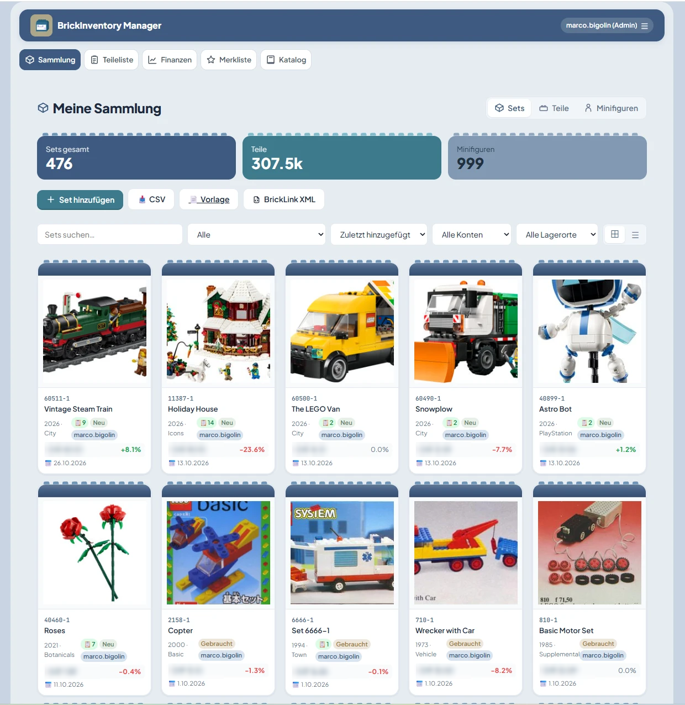
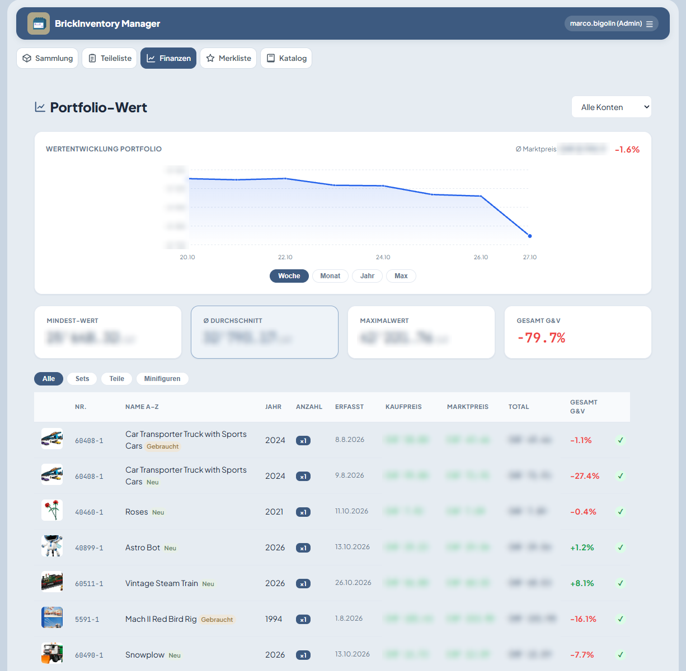
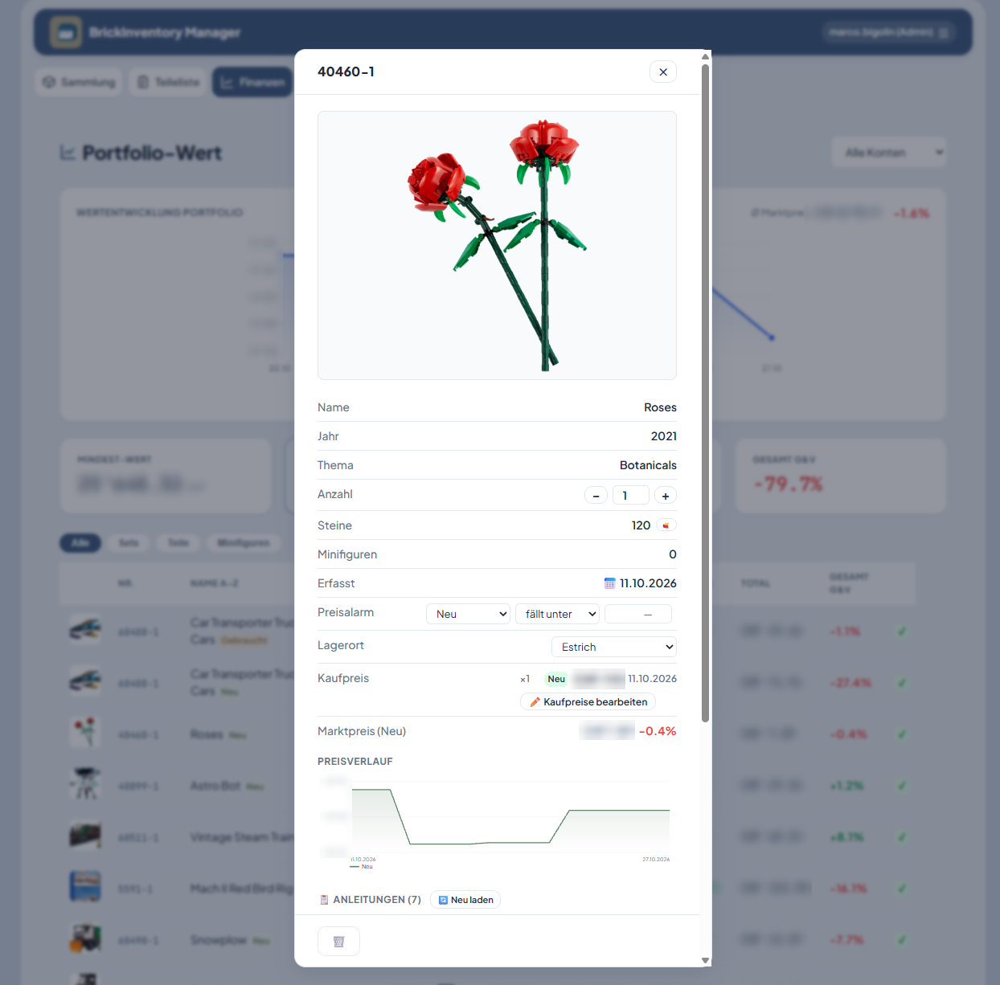
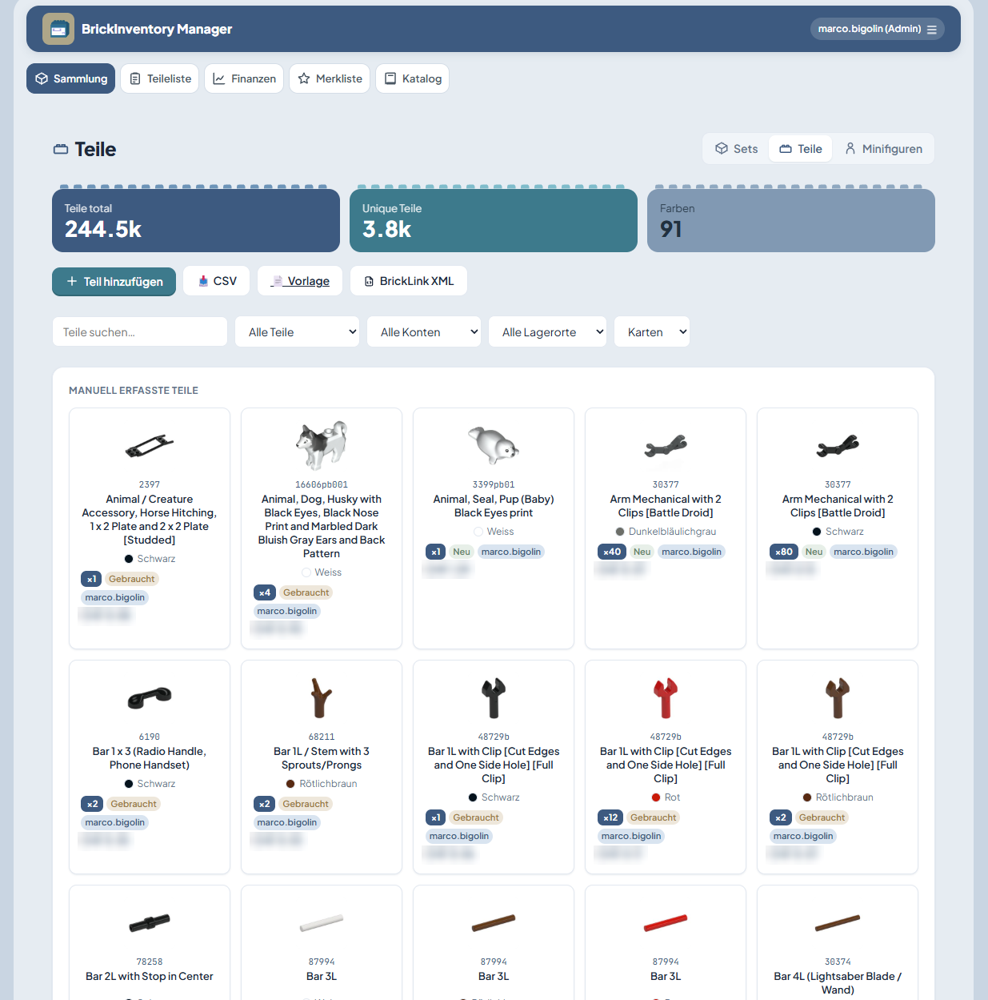
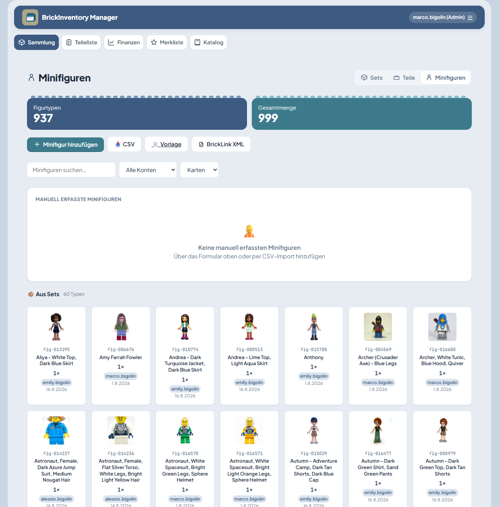

<div align="center">


# BrickInventory Manager

**Selbstgehostete Verwaltung für Klemmbaustein-Sammlungen** — Web-Oberfläche,
Android-App und ein gemeinsamer Server.

Sets erfassen, Teile und Minifiguren im Blick behalten, Marktwerte über
BrickLink verfolgen, Anleitungen automatisch von Brickset holen.

[](https://github.com/addict85/BrickInventory/actions/workflows/android.yml)
[](https://github.com/addict85/BrickInventory/actions/workflows/docker-publish.yml)

</div>

---

## Die Oberfläche



*Die Sammlung: Sets als Kacheln mit Bild, Zustand, Konto und Wertentwicklung.
Suchen, nach Thema, Konto und Lagerort filtern, sortieren; anlegen einzeln, per
CSV oder aus einer BrickLink-XML-Liste.*

<table>
<tr>
<td width="50%"></td>
<td width="50%"></td>
</tr>
<tr>
<td><b>Finanzen</b> — Portfolio-Wert über BrickLink-Preise, Verlauf nach Woche,
Monat, Jahr; Kaufpreis gegen Marktwert je Set, Teil und Minifigur.</td>
<td><b>Set-Detail</b> — Anzahl, Lagerort, Kaufpreise je Erfassung,
Marktpreis mit Verlauf, Preisalarm und die Anleitungen.</td>
</tr>
<tr>
<td></td>
<td></td>
</tr>
<tr>
<td><b>Teile</b> — einzeln erfasst oder aus Sets übernommen, mit Farbe,
Zustand, Konto und Lagerort.</td>
<td><b>Minifiguren</b> — manuell erfasst oder aus den Sets der Sammlung
abgeleitet.</td>
</tr>
</table>

> Die Aufnahmen stammen aus einer echten Sammlung. Alle Beträge sind
> unkenntlich gemacht.

---

## Was drin ist

| | |
| --- | --- |
| **Sammlung** | Sets, Teile und Minifiguren — einzeln, per CSV, per BrickLink-XML oder per Barcode in der App; Lagerorte, Zustand Neu/Gebraucht, mehrere Erfassungen mit eigenem Kaufpreis |
| **Finanzen** | Portfolio-Wert über BrickLink-Preise, Kaufpreis gegen Marktwert, Verlauf, Preisalarme, Gutscheine |
| **Merkliste** | gesuchte Sets und Teile, Import der BrickLink-Wanted-Liste |
| **Katalog** | Set-Suche über Rebrickable, mit Jahres-Regler |
| **Teileliste** | alle Teile eines Sets, Abgleich mit dem eigenen Bestand, PDF-Export |
| **Anleitungen** | automatisch geholt (Rebrickable, Brickset und weitere Quellen), eigene PDFs und Bilder hochladbar |
| **Haushalt** | Konten verknüpfen: Ein Elternkonto sieht und bearbeitet die Sammlungen seiner direkt verknüpften Kinder; ein Kind kann mehrere Elternkonten haben (z. B. beide Eltern) |
| **Papierkorb** | Gelöschtes bleibt 30 Tage wiederherstellbar |
| **Sicherheit** | zweiter Faktor (TOTP) mit Wiederherstellungscodes, Anmeldesperre je Konto mit wachsender Wartezeit, Sitzungen mit fester Höchstdauer, App-Tokens mit Ablauf; Verwalteraktionen an fremden Konten nur mit eigenem Passwort und im Protokoll |
| **Einrichtung** | Assistent beim ersten Start; Verwaltung mit Monitoring der Hintergrundläufe und Protokoll |
| **Aussehen** | fünf Designs, hell und dunkel, für Telefon und Desktop |
| **Mehrsprachig** | Deutsch und Englisch, Währung frei wählbar |

---

## Schnellstart

Der einfachste Weg ist Docker mit Compose. PostgreSQL und Caddy (HTTPS) kommen
mit; die App selbst veröffentlicht keinen Port. Alles im Ordner `Web-App/`:

```bash
git clone https://github.com/addict85/BrickInventory.git
cd BrickInventory/Web-App
cp .env.example .env
echo BRICK_HOST=nas.example.lan >> .env   # Name oder IP-Adresse des Servers
echo VORGELAGERTER_PROXY=keiner >> .env   # oder die Adresse eines Proxys davor (README, „Proxy vor Caddy“)
sh scripts/geheimnisse-einrichten.sh      # Sitzungsgeheimnis und DB-Passwörter nach ./geheimnisse/
sudo sh scripts/ca-einrichten.sh          # eigene CA, die nur für BRICK_HOST gilt
sh scripts/image-pruefen.sh               # Signatur prüfen, Image als Digest in .env, pull (braucht cosign)
docker compose up -d
docker compose logs app jobs | grep -A2 Standard-Admin   # Erstpasswort von admin
```

→ `https://<BRICK_HOST>` (Port 80 leitet um). Das Wurzelzertifikat der eigenen
CA liegt unter `http://<BRICK_HOST>/ca.crt`; vor dem Installieren auf einem
Gerät den Fingerabdruck vergleichen, den `scripts/ca-einrichten.sh` ausgibt.

- **Öffentlicher Name statt eigener CA:** `BRICK_TLS=acme` (und optional
  `ACME_EMAIL`) in `.env`; `scripts/ca-einrichten.sh` entfällt, das Zertifikat
  kommt von Let's Encrypt.
- **Geheimnisse** stehen nicht in `.env`, sondern als Dateien in
  `./geheimnisse/` und gehen als Docker-Secrets in die Container.
- **Das Image** zieht compose nur als Digest aus `BRICK_IMAGE`; das trägt
  `scripts/image-pruefen.sh` nach bestandener Signaturprüfung ein (cosign
  muss installiert sein).
- **Selbst bauen** statt ziehen: `BRICK_IMAGE=brickinventory:lokal` in `.env`,
  dann `docker compose up -d --build`.
- **Update:** `sh scripts/image-pruefen.sh && docker compose up -d`; vorher
  `Web-App/UPGRADE.md` lesen.

Das Passwort des Kontos `admin` steht nur beim allerersten Start im Protokoll
und muss bei der ersten Anmeldung geändert werden. Einzelheiten, Sicherung und
alle Variablen: [`Web-App/README.md`](Web-App/README.md).

### Auf dem Raspberry Pi

Das Image wird als Multi-Arch-Manifest veröffentlicht, `docker` wählt die
passende Architektur selbst:

| Plattform | deckt ab |
| --- | --- |
| `linux/amd64` | PC, Server, NAS, jede x86-Cloud |
| `linux/arm64` | Raspberry Pi 3/4/5 und Zero 2 W (**64-Bit-System**), Apple Silicon, ARM-Server |

`docker` holt die passende Fassung. 32-Bit (`armv7`) wird nicht
unterstützt: Für Alpine (musl) auf armv7 gibt es kein `sharp`, die
Bildverarbeitung fiele still auf den langsamen Rückfall zurück.

Jedes veröffentlichte Image ist mit [cosign](https://docs.sigstore.dev/)
signiert (keyless, aus dem Workflow `docker-publish.yml` auf `main`).
`scripts/image-pruefen.sh` prüft das vor jeder Übernahme; von Hand:

```bash
cosign verify addict85/brickinventory:latest \
  --certificate-identity https://github.com/addict85/BrickInventory/.github/workflows/docker-publish.yml@refs/heads/main \
  --certificate-oidc-issuer https://token.actions.githubusercontent.com
```

Dasselbe gilt für das Caddy-Image `addict85/brickinventory-caddy` (gleiche
Identität, gleicher Aussteller).

Dazu tragen die Images eine Herkunftsbescheinigung (SLSA-Provenance: welcher
Workflow, welcher Commit) und eine Stückliste (SBOM; npm-Pakete als CycloneDX,
dazu die Pakete des Basis-Images; für Caddy liest Trivy die Stückliste aus dem
Image). Prüfen mit der GitHub-CLI (für Caddy `brickinventory-caddy`):

```bash
gh attestation verify oci://docker.io/addict85/brickinventory:latest -R addict85/BrickInventory
gh attestation verify oci://docker.io/addict85/brickinventory:latest -R addict85/BrickInventory \
  --predicate-type https://cyclonedx.org/bom
```

---

## Die Android-App


Kotlin und Jetpack Compose, `minSdk 30` (Android 11), `compileSdk`/`targetSdk` 37.
Spricht ausschliesslich über `/api/v1/` mit Bearer-Token — die
Geräteverwaltung liegt in der Weboberfläche unter *Einstellungen → Angemeldete Geräte*.
Anmeldung wahlweise über den QR-Code für die Android-App aus den Einstellungen.

<br clear="left">

Barcode- und Texterkennung für das Erfassen unterwegs, Sammlung, Teileliste,
Merkliste, Katalog, Finanzen, Anleitungen als PDF und die Verwaltung des
zweiten Faktors.

**Verbindung zum Server:** Am besten über HTTPS. Ein selbst ausgestelltes
Zertifikat geht, sobald die eigene Zertifizierungsstelle auf dem Telefon
installiert ist (*Einstellungen → Sicherheit → Verschlüsselung und
Anmeldedaten → Zertifikat installieren*); die App vertraut solchen
Zertifikaten nur für den eigenen Server, nicht für ihre Updates. Ohne HTTPS
verbindet sich die App nicht: Klartext (`http://`) lehnt sie ab, auch im
Heimnetz.

> **Screenshots der App fehlen hier noch.** Sie lassen sich nur auf einem Gerät
> oder Emulator aufnehmen; in der Umgebung, in der dieses README entstanden
> ist, war beides nicht verfügbar. Zum Ergänzen: Aufnahmen nach
> `docs/screenshots/` legen (z. B. `android-galerie.png`) und hier einbinden.

Bauen:

```bash
cd Android-App
./gradlew assembleRelease      # → app/build/outputs/apk/release/
```

Die neuste fertige APK liegt hier — **ein Klick, kein Zip, kein GitHub-Konto**:

**<https://github.com/addict85/BrickInventory/releases/latest/download/BrickInventory.apk>**

Der Link bleibt über alle Builds derselbe: GitHub leitet ihn auf die als
„Latest“ markierte Release um, und jedes Etikett `android-v…` legt eine neue,
unveränderliche Release mit dem APK an
([Android-Release](https://github.com/addict85/BrickInventory/actions/workflows/android-release.yml)).
Signiert und veröffentlicht wird nur ein Etikett auf `main`; andere Zweige ergeben ein
unsigniertes APK, das nur als Artefakt des Laufs liegt. Siehe [`Android-App/README.md`](Android-App/README.md).

Der frühere Link `…/releases/download/apk-neuste/BrickInventory.apk` ist eingefroren
(Stand 2.11.2026). Eine App, die vor dieser Umstellung installiert wurde, findet
das Update darum nicht selbst: einmal von Hand über den Link oben installieren.

---

## Aufbau

```
Web-App/       Node.js + TypeScript + Express, PostgreSQL, Docker
Android-App/   Kotlin + Jetpack Compose, Hilt, Retrofit, CameraX + ML Kit
```

| | Web-App | Android-App |
| --- | --- | --- |
| Sprache | TypeScript (~33 300 Zeilen im Server) | Kotlin (138 Dateien) |
| Tests | 578 Testdateien | 120 Testdateien, 575 Prüfungen |
| Laufzeit | Node 26, PostgreSQL 18 | Android 11+ (API 30) |

Beide Bäume tragen eine ausführliche Änderungshistorie mit Begründungen:
[`Web-App/CHANGELOG-fixes.md`](Web-App/CHANGELOG-fixes.md) und
[`Android-App/CHANGELOG-fixes.md`](Android-App/CHANGELOG-fixes.md). Die
Invarianten der App stehen in
[`Android-App/INVARIANTEN.md`](Android-App/INVARIANTEN.md).

Das vollständige Datenbankschema steht in
[`Web-App/db/schema-stand.sql`](Web-App/db/schema-stand.sql) — erzeugt aus
einer frischen Datenbank, zum Lesen. Eine neue Installation bekommt ihr
Schema aus `db/basis.sql` und danach die jüngeren `db/migrations/`; nach einer
Migration beide Dateien mit `npm run build && npm run schema:stand` neu
schreiben (braucht `pg_dump`; der Schema-Test meldet einen veralteten Stand).

---

## Entwickeln

```bash
# Web-App
cd Web-App && npm ci --ignore-scripts && npm rebuild esbuild
npm run build
TEST_DATABASE_URL=postgres://…  REQUIRE_DB=1  npm test

# Android-App
cd Android-App && ./gradlew testDebugUnitTest
```

`REQUIRE_DB=1` ist nicht optional: Ohne die Variable überspringen die
Datenbank-Suiten sich selbst, und der Lauf ist grün, ohne die Hälfte geprüft
zu haben.

Ausführliche Anleitungen: [`Web-App/README.md`](Web-App/README.md) ·
[`Android-App/README.md`](Android-App/README.md)
