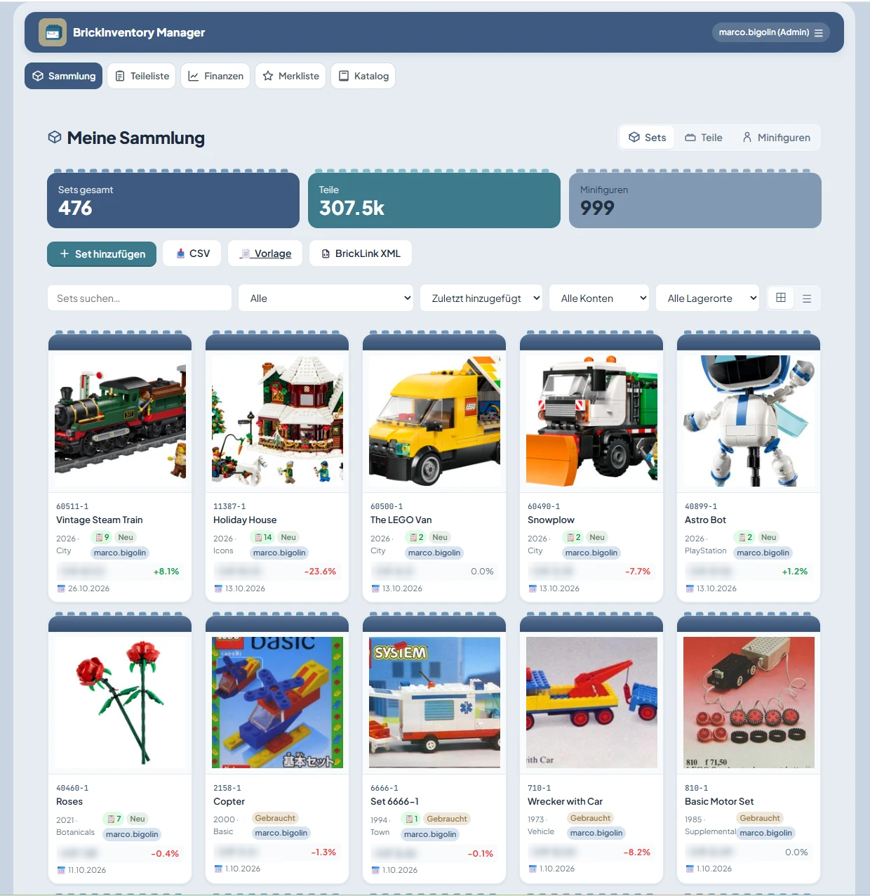
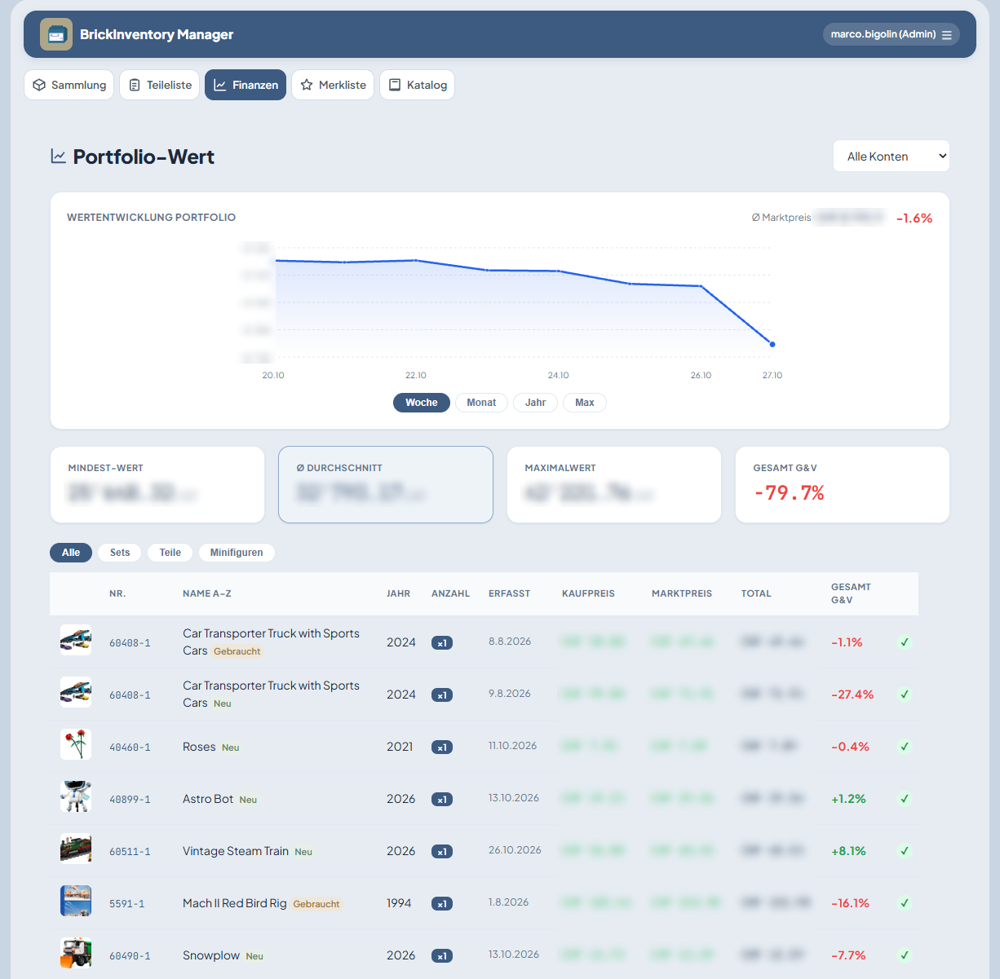
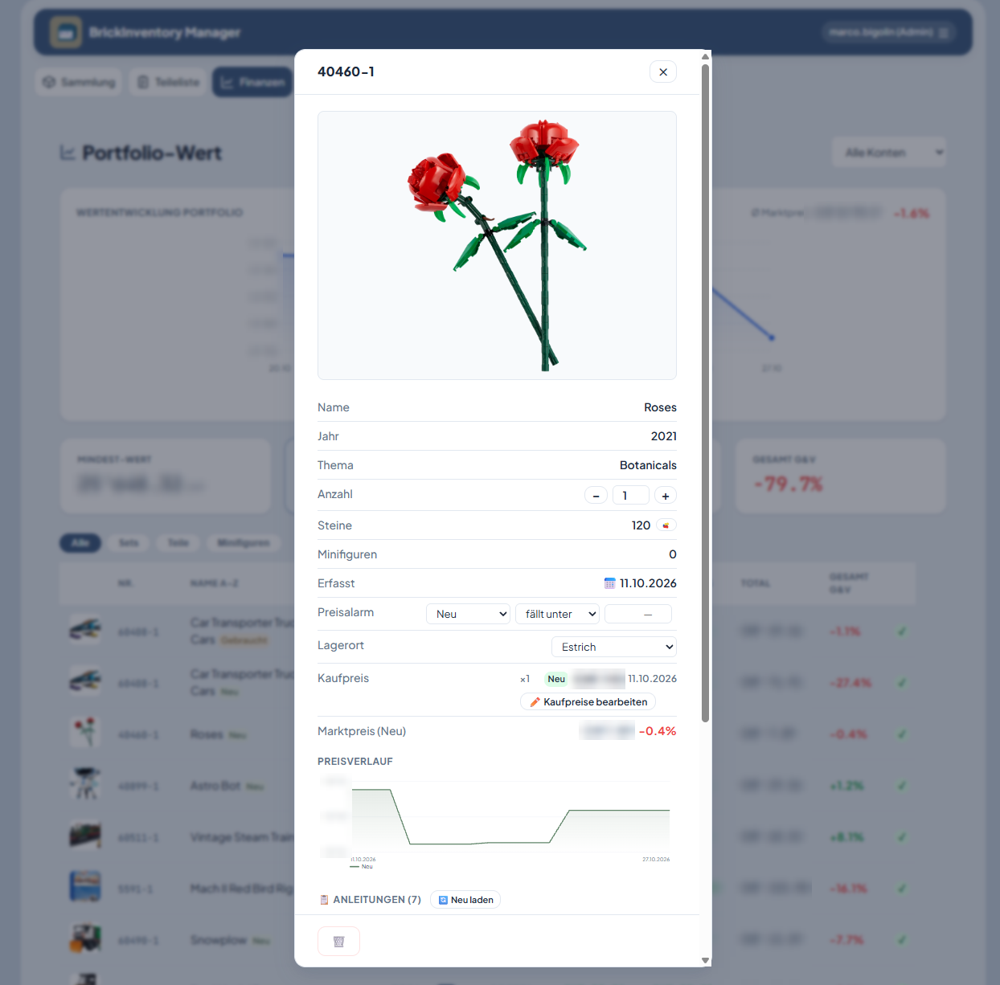
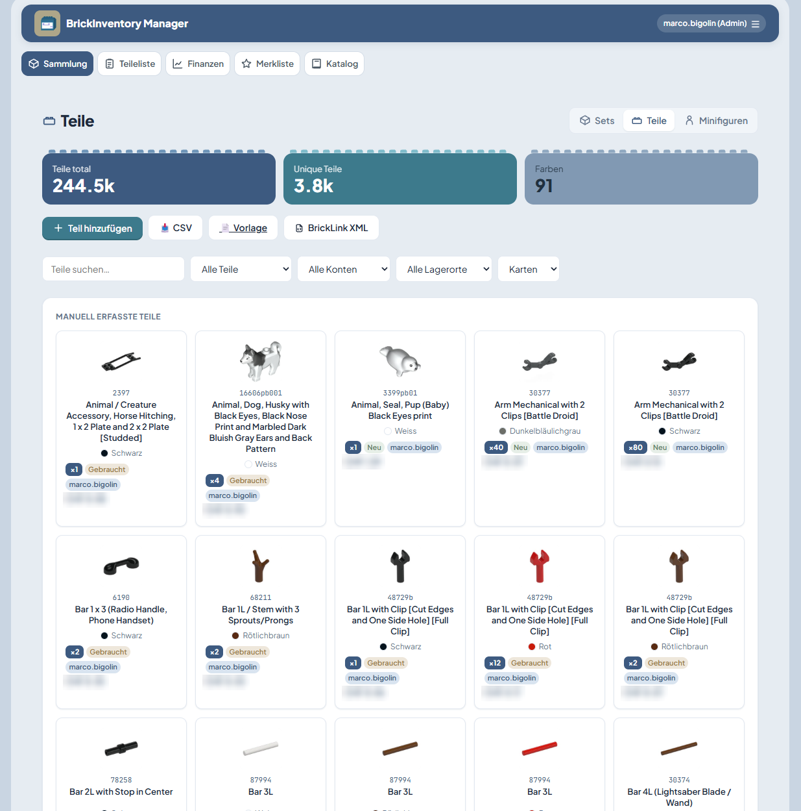
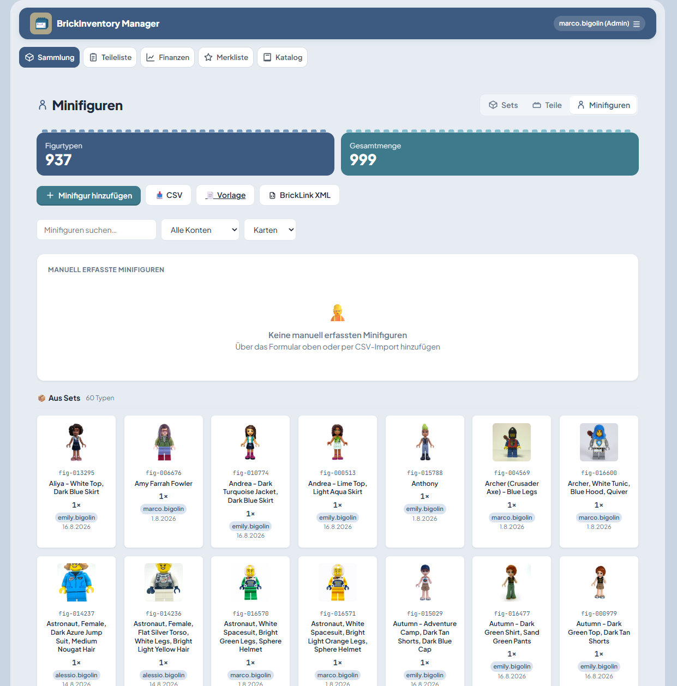

<div align="center">


# BrickInventory Manager

**Selbstgehostete Verwaltung für Klemmbaustein-Sammlungen** — Web-Oberfläche,
Android-App und ein gemeinsamer Server.

Sets erfassen, Teile und Minifiguren im Blick behalten, Marktwerte über
BrickLink verfolgen, Anleitungen automatisch von Brickset holen.

[](https://github.com/addict85/BrickInventory/actions/workflows/android.yml)
[](https://github.com/addict85/BrickInventory/actions/workflows/docker-publish.yml)

</div>

---

## Die Oberfläche



*Die Sammlung: Sets als Kacheln mit Bild, Zustand, Konto und Wertentwicklung.
Suchen, nach Thema, Konto und Lagerort filtern, sortieren; anlegen einzeln, per
CSV oder aus einer BrickLink-XML-Liste.*

<table>
<tr>
<td width="50%"></td>
<td width="50%"></td>
</tr>
<tr>
<td><b>Finanzen</b> — Portfolio-Wert über BrickLink-Preise, Verlauf nach Woche,
Monat, Jahr; Kaufpreis gegen Marktwert je Set, Teil und Minifigur.</td>
<td><b>Set-Detail</b> — Anzahl, Lagerort, Kaufpreise je Erfassung,
Marktpreis mit Verlauf, Preisalarm und die Anleitungen.</td>
</tr>
<tr>
<td></td>
<td></td>
</tr>
<tr>
<td><b>Teile</b> — einzeln erfasst oder aus Sets übernommen, mit Farbe,
Zustand, Konto und Lagerort.</td>
<td><b>Minifiguren</b> — manuell erfasst oder aus den Sets der Sammlung
abgeleitet.</td>
</tr>
</table>

> Die Aufnahmen stammen aus einer echten Sammlung. Alle Beträge sind
> unkenntlich gemacht.

---

## Was drin ist

| | |
| --- | --- |
| **Sammlung** | Sets, Teile und Minifiguren — einzeln, per CSV, per BrickLink-XML oder per Barcode in der App; Lagerorte, Zustand Neu/Gebraucht, mehrere Erfassungen mit eigenem Kaufpreis |
| **Finanzen** | Portfolio-Wert über BrickLink-Preise, Kaufpreis gegen Marktwert, Verlauf, Preisalarme, Gutscheine |
| **Merkliste** | gesuchte Sets und Teile, Import der BrickLink-Wanted-Liste |
| **Katalog** | Set-Suche über Rebrickable, mit Jahres-Regler |
| **Teileliste** | alle Teile eines Sets, Abgleich mit dem eigenen Bestand, PDF-Export |
| **Anleitungen** | automatisch geholt (Rebrickable, Brickset und weitere Quellen), eigene PDFs und Bilder hochladbar |
| **Haushalt** | Konten verknüpfen: Ein Elternkonto sieht und bearbeitet die Sammlungen seiner direkt verknüpften Kinder; ein Kind kann mehrere Elternkonten haben (z. B. beide Eltern) |
| **Papierkorb** | Gelöschtes bleibt 30 Tage wiederherstellbar |
| **Sicherheit** | zweiter Faktor (TOTP) mit Wiederherstellungscodes, Anmeldesperre je Konto mit wachsender Wartezeit, Sitzungen mit fester Höchstdauer, App-Tokens mit Ablauf; Verwalteraktionen an fremden Konten nur mit eigenem Passwort und im Protokoll |
| **Einrichtung** | Assistent beim ersten Start; Verwaltung mit Monitoring der Hintergrundläufe und Protokoll |
| **Aussehen** | fünf Designs, hell und dunkel, für Telefon und Desktop |
| **Mehrsprachig** | Deutsch und Englisch, Währung frei wählbar |

---

## Schnellstart

Der einfachste Weg ist Docker. Postgres kommt mit.

```bash
git clone https://github.com/addict85/BrickInventory.git
cd BrickInventory/Web-App
# SESSION_SECRET in compose.yaml auf einen eigenen Zufallswert setzen:
#   openssl rand -base64 48
docker compose up -d
```

→ <http://localhost:3000>

Das Passwort des Kontos `admin` wird beim allerersten Start **einmalig ins
Log** geschrieben (`docker compose logs app`) — oder vorab über
`ADMIN_PASSWORD` gesetzt.

Vor dem ersten Start lohnen zwei weitere Werte in einer `.env` neben
`compose.yaml`:

- `DB_PASSWORD` — Pflicht. Ohne startet `docker compose` nicht, und mit dem
  alten Beispielpasswort `brickinventory_secret` verweigert der Server den
  Start. Eine bestehende Datenbank behält ihr Passwort; dann den bisherigen
  Wert eintragen (oder ändern, siehe `Web-App/UPGRADE.md`).
- `APP_BIND=127.0.0.1` — wenn ein Reverse-Proxy (Caddy, nginx, Traefik) davor
  steht. Port 3000 ist dann nur noch auf dem Rechner selbst erreichbar und
  nicht am Proxy vorbei im ganzen Netz.
- `TRUST_PROXY=<Adresse>` — die feste Adresse dieses Proxys, sonst gelten alle
  Clients als dieselbe Adresse (Anmeldesperre, Drosseln). Im Compose-Netz
  bekommt der Proxy eine feste Adresse aus `172.28.73.0/24`, etwa
  `172.28.73.10`. Ohne Angabe glaubt der Server nur Loopback; einem ganzen
  Netz (früher `docker`) glaubt er nicht mehr.

### Auf dem Raspberry Pi

Das Image wird als Multi-Arch-Manifest veröffentlicht, `docker` wählt die
passende Architektur selbst:

| Plattform | deckt ab |
| --- | --- |
| `linux/amd64` | PC, Server, NAS, jede x86-Cloud |
| `linux/arm64` | Raspberry Pi 3/4/5 und Zero 2 W (**64-Bit-System**), Apple Silicon, ARM-Server |

```bash
docker compose pull && docker compose up -d
```

32-Bit (`armv7`) wird nicht unterstützt — Details und Begründung in
[`Web-App/README.md`](Web-App/README.md).

Jedes veröffentlichte Image ist mit [cosign](https://docs.sigstore.dev/)
signiert (keyless, aus dem Workflow `docker-publish.yml` auf `main`). Prüfen:

```bash
cosign verify addict85/brickinventory:latest \
  --certificate-identity https://github.com/addict85/BrickInventory/.github/workflows/docker-publish.yml@refs/heads/main \
  --certificate-oidc-issuer https://token.actions.githubusercontent.com
```

---

## Die Android-App


Kotlin und Jetpack Compose, `minSdk 26`, `compileSdk`/`targetSdk` 37.
Spricht ausschliesslich über `/api/v1/` mit Bearer-Token — die
Geräteverwaltung liegt in der Weboberfläche unter *Einstellungen → Angemeldete Geräte*.
Anmeldung wahlweise über den QR-Code für die Android-App aus den Einstellungen.

<br clear="left">

Barcode- und Texterkennung für das Erfassen unterwegs, Sammlung, Teileliste,
Merkliste, Katalog, Finanzen, Anleitungen als PDF und die Verwaltung des
zweiten Faktors.

**Verbindung zum Server:** Am besten über HTTPS. Ein selbst ausgestelltes
Zertifikat geht, sobald die eigene Zertifizierungsstelle auf dem Telefon
installiert ist (*Einstellungen → Sicherheit → Verschlüsselung und
Anmeldedaten → Zertifikat installieren*); die App vertraut solchen
Zertifikaten nur für den eigenen Server, nicht für ihre Updates. Ohne HTTPS
erlaubt die App Klartext nur zu Adressen im Heimnetz und zu Hosts, die man in
der Einrichtung ausdrücklich bestätigt hat. Vor dem ersten Zugang in jedem
Netz muss sich der Server dann ausweisen (er beweist, dass er den Token
kennt, ohne ihn zu senden) — so geht der Token im fremden WLAN nicht an
einen anderen Rechner, der sich `nas` nennt.

Klartext im Heimnetz ist eine bewusste Entscheidung mit einer Grenze: Der
Serverbeweis schützt vor einem falschen Server, nicht vor Mithören. Wer im
selben WLAN den Verkehr mitliest, sieht Token und Daten. Wer das nicht
hinnehmen will, richtet HTTPS ein.

> **Screenshots der App fehlen hier noch.** Sie lassen sich nur auf einem Gerät
> oder Emulator aufnehmen; in der Umgebung, in der dieses README entstanden
> ist, war beides nicht verfügbar. Zum Ergänzen: Aufnahmen nach
> `docs/screenshots/` legen (z. B. `android-galerie.png`) und hier einbinden.

Bauen:

```bash
cd Android-App
./gradlew assembleRelease      # → app/build/outputs/apk/release/
```

Die neuste fertige APK liegt hier — **ein Klick, kein Zip, kein GitHub-Konto**:

**<https://github.com/addict85/BrickInventory/releases/download/apk-neuste/BrickInventory.apk>**

Der Link bleibt über alle Builds derselbe; der
[Android-Workflow](https://github.com/addict85/BrickInventory/actions/workflows/android.yml)
ersetzt nur die Datei dahinter. Signiert und veröffentlicht wird nur ein Build
von `main` mit den vier Keystore-Secrets; andere Zweige ergeben ein
unsigniertes APK, das nur als Artefakt des Laufs liegt. Siehe [`Android-App/README.md`](Android-App/README.md).

---

## Aufbau

```
Web-App/       Node.js + TypeScript + Express, PostgreSQL, Docker
Android-App/   Kotlin + Jetpack Compose, Hilt, Retrofit, CameraX + ML Kit
```

| | Web-App | Android-App |
| --- | --- | --- |
| Sprache | TypeScript (~31 700 Zeilen) | Kotlin (138 Dateien) |
| Tests | 332 Testdateien | 120 Testdateien, 575 Prüfungen |
| Laufzeit | Node 26, PostgreSQL 18 | Android 8.0+ (API 26) |

Beide Bäume tragen eine ausführliche Änderungshistorie mit Begründungen:
[`Web-App/CHANGELOG-fixes.md`](Web-App/CHANGELOG-fixes.md) und
[`Android-App/CHANGELOG-fixes.md`](Android-App/CHANGELOG-fixes.md). Die
Invarianten der App stehen in
[`Android-App/INVARIANTEN.md`](Android-App/INVARIANTEN.md).

Das vollständige Datenbankschema steht in
[`Web-App/db/schema-stand.sql`](Web-App/db/schema-stand.sql) — erzeugt aus
einer frischen Datenbank, zum Lesen. Eine neue Installation bekommt ihr
Schema aus `db/basis.sql` und danach die jüngeren `db/migrations/`; nach einer
Migration beide Dateien mit `npm run build && npm run schema:stand` neu
schreiben (braucht `pg_dump`; der Schema-Test meldet einen veralteten Stand).

---

## Entwickeln

```bash
# Web-App
cd Web-App && npm ci
npm run build
TEST_DATABASE_URL=postgres://…  REQUIRE_DB=1  npm test

# Android-App
cd Android-App && ./gradlew testDebugUnitTest
```

`REQUIRE_DB=1` ist nicht optional: Ohne die Variable überspringen die
Datenbank-Suiten sich selbst, und der Lauf ist grün, ohne die Hälfte geprüft
zu haben.

Ausführliche Anleitungen: [`Web-App/README.md`](Web-App/README.md) ·
[`Android-App/README.md`](Android-App/README.md)
